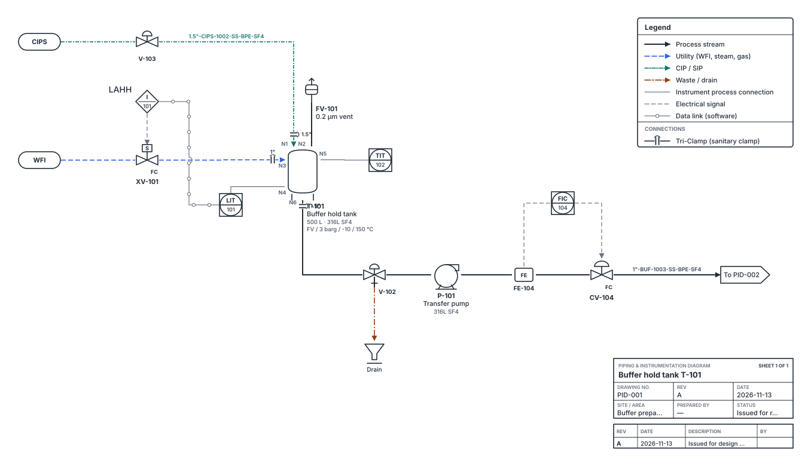

# Pidgeon

**Free, open-source editor for pharma process diagrams: PFDs, P&IDs and single-use assembly drawings. Runs entirely in your browser.**

[Open the editor](https://pidgeon.studio/app/) · [Website](https://pidgeon.studio/) · [Guide](https://pidgeon.studio/guide.html)



## What it does

- **Process flow diagrams** with symbols for upstream, harvest, purification, fill–finish and oral solid dose; cleanroom zones by EU GMP Annex 1 grade; single-use badges.
- **P&IDs** with ISA-5.1 instruments and loops, hygienic valves, line tags (`size-service-number-class-insulation`), nozzle numbers, line jumps, and multi-sheet drawings with linked off-page connectors.
- **Single-use assembly drawings** with tubing material / ID × OD / length, aseptic connectors, clamps and fittings, assembly boundaries and an automatic bill of materials.
- **Exports:** vector PDF (one page per sheet), DXF R12 for CAD (one file per sheet, layered), PNG/SVG, and the editable JSON drawing.
- **Lists:** equipment list, line list, instrument index, valve list, connection schedule and BOM as CSV, plus a drawing check.

## Privacy

There is no server, account, analytics or cookies. Drawings are kept in the browser's local storage and in files the user saves. The page makes no third-party network requests.

## Run it yourself

It is a static site. Clone or download the repository and either:

- open `app/index.html` directly in a browser, or
- serve the folder with any web server (`python3 -m http.server`), or host it on GitHub Pages, Netlify, Cloudflare Pages or an internal server.

## Changing the conventions

Service codes, pipe classes, insulation codes and tag prefixes are short lists near the top of `app/index.html`: `SERVICES`, `SPECS`, `INSUL`, and the `prefix` on each symbol. Edit them to match a site standard.

## Repository layout

```
index.html        website home page
guide.html        user guide
app/index.html    the editor (single file)
app/lib/          PDF export libraries and embedded font, loaded on first PDF export
assets/           website styles, fonts, logo and example drawings
licenses/         third-party licence texts (see NOTICE.md)
```

## Not validated software

Pidgeon is intended for concept work, design reviews and mark-ups. Drawings that support GMP decisions should be issued through your controlled document system. Provided as-is, without warranty; see `LICENSE`.

## Contributing

Bug reports, symbol requests and pull requests are welcome via [GitHub issues](https://github.com/MinaryBytes/Pidgeon/issues). If a drawing shows the problem, attach its `.json` file after removing anything confidential.

## About

Created and maintained by Minhazuddin Mohammed ([MinaryBytes](https://github.com/MinaryBytes), [LinkedIn](https://www.linkedin.com/in/minhazuddinm/)). To cite Pidgeon, use **Cite this repository** on GitHub (from `CITATION.cff`).

## Licence

MIT. Third-party components are listed in [NOTICE.md](NOTICE.md).
